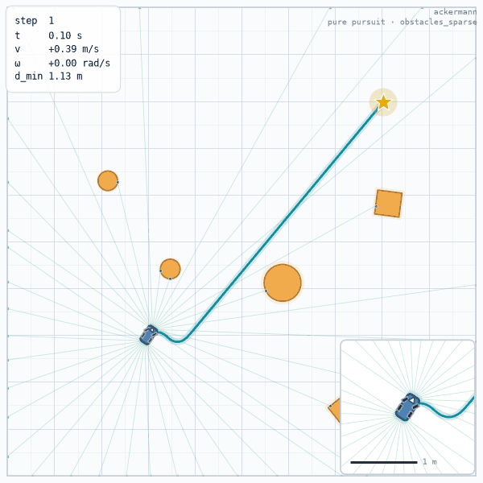
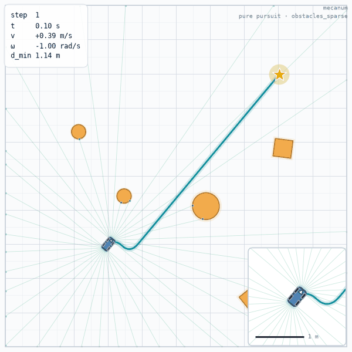
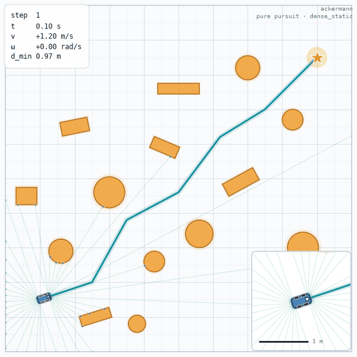
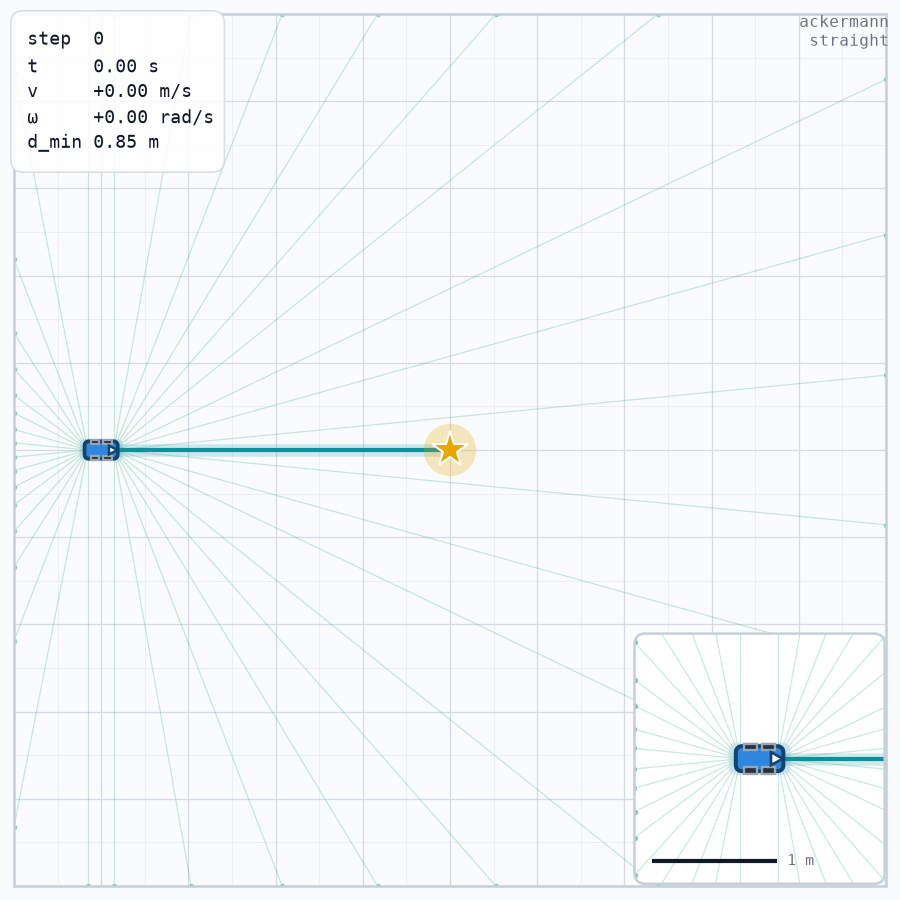
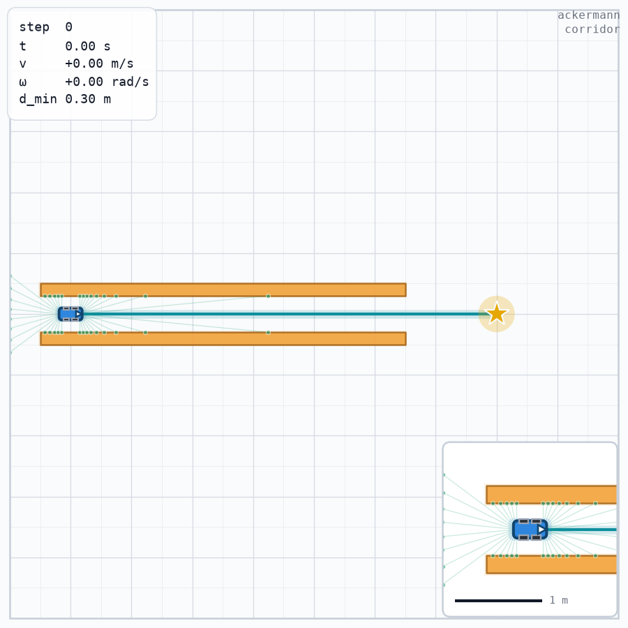
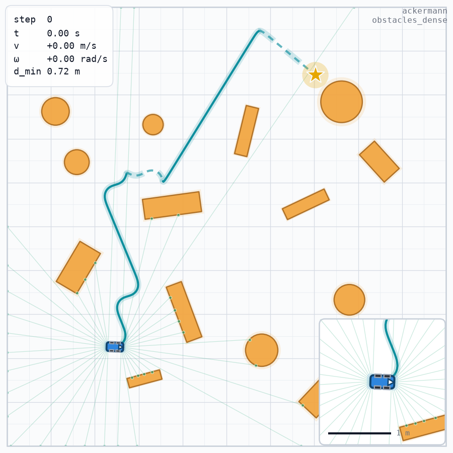
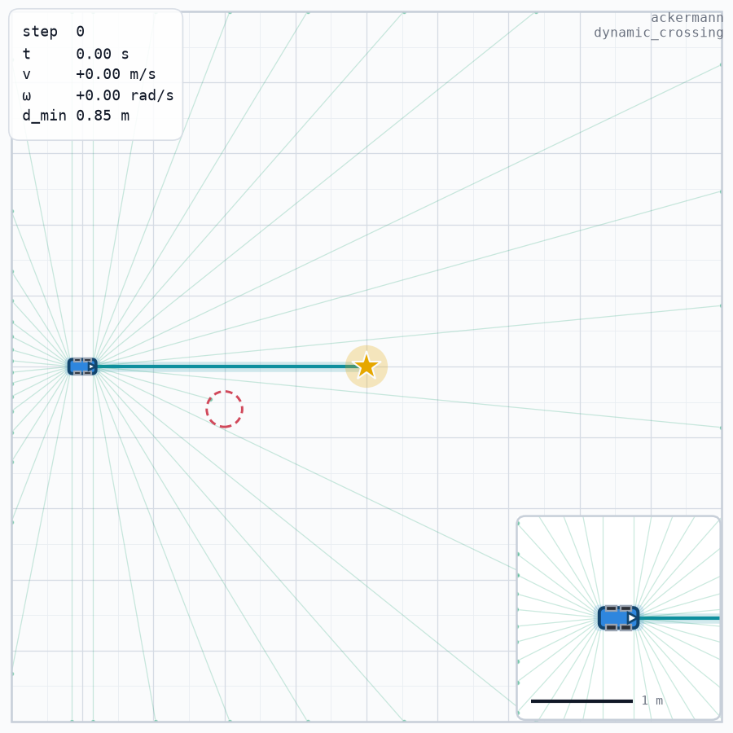

# chassis-sim

English | [简体中文](https://github.com/ravenkernel/chassis-sim/blob/main/README.zh-CN.md)

[](https://github.com/ravenkernel/chassis-sim/actions/workflows/ci.yml)
[](https://github.com/ravenkernel/chassis-sim)
[](LICENSE)
[](https://colab.research.google.com/github/ravenkernel/chassis-sim/blob/main/examples/quickstart.ipynb)

**A lightweight, reproducible workbench for chassis control, observations, and rewards** — Ackermann steering, differential drive, and mecanum, with a NumPy core, behind a Gymnasium API.

chassis-sim is for the loop where you change a controller, an observation layout, or one reward term and want to know what happened before your coffee is cold. One process, one robot, one map, explicit seeds, no simulator install. The package is deliberately small; the parts it does implement are specified down to the bit.

**It is not** an authoritative physics simulator, a contact simulator, or a multi-agent benchmark suite. If you need contact forces, tire models, or thousands of environments on a GPU, use a real physics stack. chassis-sim is the layer where you test the parts that do not need one.

## What it is (and is not)

Use it when you want to:

- iterate on a path tracker, a reward function, or an observation layout without rebuilding a simulation stack;
- pin a regression: `reset(seed=...)` reproduces the map, the sensor stream, and the trajectory;
- teach or demo chassis kinematics with a readable, dependency-light implementation;
- compare reference controllers on a fixed protocol, with the sample-independence check built in.

Skip it when you need:

- authoritative dynamics: suspension, tire slip, load transfer, 3D, or contact-rich interaction;
- a leaderboard: the evaluation harness is for your own baselines, not for ranking the world;
- GPU-scale rollouts: one environment is one Python object on the CPU.

Three boundaries we do not hide:

1. **Chassis-level kinematics, not wheel-level rigid-body dynamics.** The state is `(x, y, θ)` and each step integrates a constant twist in closed form. The wheel layer reports steering angles and wheel speeds for logging and downstream control; it never feeds back into the integrator. There is no suspension, no slip, no load transfer, and no 3D.
2. **Collision is a geometric predicate.** Rectangle/circle overlap plus optional swept sampling. A collision is a boolean that terminates the episode; there are no contact forces, no friction, and no pushing.
3. **No GPU and no built-in vectorized batch.** Use Gymnasium vector wrappers if you need parallelism; the library itself does not provide a batched simulator.

## How it compares

The projects below are not worse — they answer a different question. The question here is how long it takes to get from one controller, one observation layout, or one reward term to a number you trust.

| Alternative | What it is built for | What this package does instead |
| --- | --- | --- |
| PyBullet, MuJoCo, Gazebo | rigid-body contact dynamics, joints, force and torque sensors | closed-form twist integration plus a geometric collision predicate; nothing to compile or install |
| CARLA, DonkeyCar (Unity-based) | photorealistic cameras and vehicle dynamics inside a game engine | one top-down matplotlib frame from `render()` inside a CPU-only process |
| ir-sim and similar 2D mobile-robot simulators | 2D kinematics plus plotting for mobile robots | three named chassis behind one normalized action space, with a finite observation box per segment |
| general Gymnasium benchmark suites | standard tasks with published leaderboards | a benchmark protocol you run on your own baselines, with the sample-independence check built in |

If the question is about contact forces, tire slip, or perception, take the first two rows. If it is about whether your tracker still works after you move one reward term, the engines cost more time to install than the experiment costs to run.

## At a glance

Three chassis, one normalized action interface, finite observation boxes, Gymnasium ids at `-v1`.

| Gymnasium id | Chassis | Action layout | Default obs | Physical limits (default `EnvConfig`) |
| --- | --- | --- | ---: | --- |
| `ChassisSim-Ackermann-v1` | Ackermann | `[steer, speed]` | 128 | `v ∈ [-0.6, 1.2] m/s`, `δ ∈ [-0.526, 0.526] rad`, `|ω| ≤ 4.805 rad/s` |
| `ChassisSim-DiffDrive-v1` | differential drive | `[speed, yaw]` | 128 | `v ∈ [-1.2, 1.2] m/s`, `|ω| ≤ 1.0 rad/s` |
| `ChassisSim-Mecanum-v1` | mecanum | `[vx, vy, yaw]` | 129 | `v_x ∈ [-1.2, 1.2] m/s`, `|vy| ≤ 0.5 m/s`, `|ω| ≤ 1.0 rad/s` |

All action spaces are `Box(-1, 1, (d,), float32)`; the chassis maps normalized actions to physical quantities, so you never supply volts, torques, or raw steering angles. The limits above are what `env.chassis.describe()["limits"]` reports with the default configuration. A different `EnvConfig` changes the physical mapping and the action semantics together.

3.0.0 is the API-stability line: from this release on the public API follows semantic versioning, and a breaking change requires a major version. `chassis_sim.__version__` reports the installed version.

## Installation

```bash
pip install chassis-sim
pip install "chassis-sim[planning]"
pip install "chassis-sim[viz]"
pip install "chassis-sim[dev]"
```

Python 3.10+. Core dependencies are `numpy>=1.24`, `gymnasium>=0.29`, and `pyyaml>=6.0`.

- `planning` adds `numba>=0.60`, the first release with NumPy 2 binary wheels, for the Hybrid-A* and Reeds-Shepp scenarios. The core scenes and the default `dense_static` map do not need it.
- `viz` adds `matplotlib>=3.7` and `imageio>=2.28` for recording and stills.
- `dev` adds `pytest`, `pytest-cov`, `mypy`, and `types-PyYAML`.

## Quickstart

```python
import chassis_sim as cs

env = cs.make("ackermann", max_steps=200)
obs, info = env.reset(seed=0)
print("observation:", obs.shape, obs.dtype)

for _ in range(3):
    obs, reward, terminated, truncated, info = env.step([0.2, 0.6])
print(
    "step:",
    info["step"],
    "| cte:",
    round(info["cte"], 3),
    "| done:",
    terminated or truncated,
)
```

```text
observation: (128,) float32
step: 3 | cte: -0.008 | done: False
```

`reset(seed=0)` fixes the default scene as well as the robot state. With no seed, every `reset()` re-rolls the obstacle field of the default `dense_static` scene — that is the intended behaviour, not a bug. The same seed twice produces the same map:

```python
import hashlib
import json

import chassis_sim as cs


def fingerprint(env):
    shapes = env.unwrapped.bridge.obstacle_shapes()
    blob = json.dumps(shapes, sort_keys=True).encode()
    return len(shapes), hashlib.sha256(blob).hexdigest()[:8]


env = cs.make("ackermann")
for label, kwargs in (
    ("seed=0", {"seed": 0}),
    ("seed=0 again", {"seed": 0}),
    ("no seed", {}),
    ("no seed again", {}),
):
    env.reset(**kwargs)
    count, digest = fingerprint(env)
    print(f"{label:14s} obstacles={count:2d} digest={digest}")
```

```text
seed=0         obstacles=12 digest=8e794457
seed=0 again   obstacles=12 digest=8e794457
no seed        obstacles=13 digest=1276d1b6
no seed again  obstacles=12 digest=32a57ddd
```

`reset()` chooses a scene in this order:

1. `options=` if you pass it, verbatim — including `{}`. Passing `{}` opts out of both the scenario defaults and `default_scenario`, and lands on the legacy straight fallback.
2. `env.default_reset_options` attached by `cs.make(..., scenario=...)`.
3. `EnvConfig.default_scenario` (default `"dense_static"`) when `options is None`, the environment owns its bridge, and no `map_generator` is set.
4. The legacy straight fallback when `default_scenario=None`.

Explicit options are used as given: the environment does not jitter, drop, or re-seed obstacles you supplied yourself.

```python
import numpy as np

import chassis_sim as cs

env = cs.make("ackermann", scenario="corridor")
env.reset(seed=0)
print("scenario obstacles:", len(env.unwrapped.bridge.obstacle_shapes()))

env.reset(seed=0, options={})
print("options={} obstacles:", len(env.unwrapped.bridge.obstacle_shapes()))

env.reset(
    seed=0,
    options={
        "obstacles": [
            {"shape": {"name": "circle", "radius": 0.3}, "state": [3.0, 5.0, 0.0]}
        ],
        "path_waypoints": np.array([[1.0, 5.0, 0.0], [9.0, 5.0, 0.0]]),
    },
)
print("explicit obstacles:", len(env.unwrapped.bridge.obstacle_shapes()))
```

```text
scenario obstacles: 2
options={} obstacles: 0
explicit obstacles: 1
```

## Gallery

Eleven assets, all regenerated by one command at scenario seed 0:

```bash
python examples/gallery.py --out assets
```

The five clips are 12 fps replays of real closed-loop runs: the controller drives the
env from a seed-0 reset, and the recorded action sequence is then replayed from the
identical reset state, so every clip is reproducible and every clip reaches the goal.
The six stills are the initial state of a scenario (step 0 after `reset`, chassis
`ackermann`, no controller) and carry the obstacle field, the reference path, the
body, and the chassis and scenario names in the corner. Each image links to the
full-size file under `assets/`.

### Chassis kinematics — one reference path, one controller

All three chassis drive the same `obstacles_sparse` path with the same
`pure_pursuit` controller, so the only thing that changes is the kinematics.

<table>
<tbody>
<tr>
<td align="center" width="33%"><a href="https://raw.githubusercontent.com/ravenkernel/chassis-sim/main/assets/chassis_ackermann.gif"></a><br><code>chassis_ackermann.gif</code><br><em>obstacles_sparse · ackermann · pure_pursuit</em></td>
<td align="center" width="33%"><a href="https://raw.githubusercontent.com/ravenkernel/chassis-sim/main/assets/chassis_diff_drive.gif"></a><br><code>chassis_diff_drive.gif</code><br><em>obstacles_sparse · diff_drive · pure_pursuit</em></td>
<td align="center" width="33%"><a href="https://raw.githubusercontent.com/ravenkernel/chassis-sim/main/assets/chassis_mecanum.gif"></a><br><code>chassis_mecanum.gif</code><br><em>obstacles_sparse · mecanum · pure_pursuit</em></td>
</tr>
</tbody>
</table>

Front-wheel steering is bounded by the minimum turning radius, so the Ackermann car
has to swing wide through a corner. With no lateral degree of freedom the
differential-drive turn comes from the wheel-speed difference alone, which reads as a
tighter fold on the same path. The mecanum chassis adds the orthogonal velocity
component and corrects laterally on the body itself, so it tracks the reference line
most closely.

### Controllers — one chassis, one scene

Both clips run the `ackermann` chassis on `dense_static`, so the difference is the
controller.

<table>
<tbody>
<tr>
<td align="center" width="50%"><a href="https://raw.githubusercontent.com/ravenkernel/chassis-sim/main/assets/controller_pure_pursuit.gif"></a><br><code>controller_pure_pursuit.gif</code><br><em>dense_static · ackermann · pure_pursuit</em></td>
<td align="center" width="50%"><a href="https://raw.githubusercontent.com/ravenkernel/chassis-sim/main/assets/controller_dwa.gif"></a><br><code>controller_dwa.gif</code><br><em>dense_static · ackermann · dwa</em></td>
</tr>
</tbody>
</table>

One lookahead arc gives smooth tracking with pure pursuit, but the corners are cut
and the body passes closer to the obstacles. Velocity-window sampling plus an
obstacle cost makes DWA take the more conservative line and finish in fewer steps.

### Scenarios — top-down view

<table>
<tbody>
<tr>
<td align="center" width="50%"><a href="https://raw.githubusercontent.com/ravenkernel/chassis-sim/main/assets/scene_straight.png"></a><br><code>scene_straight.png</code><br><em>straight · seed 0 · step 0 after reset</em></td>
<td align="center" width="50%"><a href="https://raw.githubusercontent.com/ravenkernel/chassis-sim/main/assets/scene_corridor.png"></a><br><code>scene_corridor.png</code><br><em>corridor · seed 0 · step 0 after reset</em></td>
</tr>
<tr>
<td align="center" width="50%"><a href="https://raw.githubusercontent.com/ravenkernel/chassis-sim/main/assets/scene_dense_static.png"></a><br><code>scene_dense_static.png</code><br><em>dense_static · seed 0 · step 0 after reset</em></td>
<td align="center" width="50%"><a href="https://raw.githubusercontent.com/ravenkernel/chassis-sim/main/assets/scene_obstacles_dense.png"></a><br><code>scene_obstacles_dense.png</code><br><em>obstacles_dense · seed 0 · step 0 after reset</em></td>
</tr>
<tr>
<td align="center" width="50%"><a href="https://raw.githubusercontent.com/ravenkernel/chassis-sim/main/assets/scene_dynamic_crossing.png"></a><br><code>scene_dynamic_crossing.png</code><br><em>dynamic_crossing · seed 0 · step 0 after reset</em></td>
<td align="center" width="50%"><a href="https://raw.githubusercontent.com/ravenkernel/chassis-sim/main/assets/scene_obstacles_sparse.png"></a><br><code>scene_obstacles_sparse.png</code><br><em>obstacles_sparse · seed 0 · step 0 after reset</em></td>
</tr>
</tbody>
</table>

`straight` is the clean baseline: no obstacle, a 4 m reference line at y = 5.
`corridor` squeezes the feasible region into a 0.6 m band between two long
rectangles, so wall clearance reads off directly. `dense_static` packs 14 circles
and rectangles against the reference path, hand-written and needing no planner.
`obstacles_dense` and `obstacles_sparse` come from the Hybrid-A* map generator, so
their obstacle field is generated per seed rather than stored in YAML: dense draws
9–15 obstacles close to the path, sparse draws 2–5 over open space.
`dynamic_crossing` has a 0.25 m circle crossing the path at 0.3 m/s on a 20 s
ping-pong cycle, drawn at its t = 0 pose.

## Observation and action contract

The observation is a single `float32` vector assembled from an ordered list of segments. `ObsSpec.default(action_dim, points=30)` is four segments — odometry, path, goal, previous action — so it is 128 values wide on the two 2-action chassis and 129 on mecanum.

| Segment | Dim | Contents |
| --- | ---: | --- |
| `Odom` | 4 | body-frame `[dx*10, dy*10, v, ω]` |
| `PathSegment(points=30)` | 120 | per point `[ρ, sin φ, cos φ, dθ]` — polar, not Cartesian |
| `Goal` | 2 | goal position in the body frame |
| `Act(action_dim)` | d | previous normalized action |
| `LidarSegment` | n_rays | scan distances in meters |
| `Err` | 2 | normalized cross-track error and heading error |
| `GoalSig` | 2 | `sin` and `cos` of the goal heading error |
| `PathValid` | 1 | 1.0 when the path segment is valid |
| `PathProgress` | 1 | arc completion in `[0, 1]` |
| `Custom` | n | your callable |

Every built-in segment declares finite bounds, and `observation_space` is a finite `Box`:

- `world_diag` is 14.142 m for the default 10 × 10 m arena; goal coordinates are bounded by it.
- Path `ρ` is bounded by `world_diag + lookahead + 0.1`. The default lookahead is 20.0 m, so the upper bound is 34.242 m. `sin φ` and `cos φ` are in `[-1, 1]`; `dθ` is in `[-π, π]`.
- Angle channels are bounded by `π`; normalized channels are bounded by `1 + 1 ulp` = ±1.0000001192092896 after the float32 widening.
- Out-of-range values are counted and then clipped. `info["obs_clipped"]` is present only when the count is greater than zero; its absence means exactly zero.

```python
import numpy as np

import chassis_sim as cs

env = cs.make("ackermann")
low, high = env.observation_space.low, env.observation_space.high
print("all finite:", bool(np.isfinite(low).all() and np.isfinite(high).all()))
print("path rho:", float(low[4]), "..", round(float(high[4]), 3))
print("normalized channel:", float(high[-1]))
```

```text
all finite: True
path rho: 0.0 .. 34.242
normalized channel: 1.0000001192092896
```

### Composing your own observation

Segments are composable: adding a lidar, a progress term, or a custom feature is a spec change, not an environment rewrite. The nine-segment, 494-dimension layout is one expression:

```python
import numpy as np

import chassis_sim as cs

env = cs.make(
    "ackermann",
    sensors=[
        cs.Lidar("front", mount=(0.145, 0, 0), n_rays=180),
        cs.Lidar("rear", mount=(-0.155, 0, np.pi), n_rays=180),
    ],
    obs=cs.ObsSpec(
        (
            cs.LidarSegment("lidar", sensors=("front", "rear")),
            cs.Odom(),
            cs.PathSegment(points=30),
            cs.Goal(),
            cs.Act(action_dim=2),
            cs.Err(),
            cs.GoalSig(),
            cs.PathValid(),
            cs.PathProgress(),
        )
    ),
)
print("obs:", env.observation_space.shape)
for name, span in env.obs_spec_describe().items():
    print(f"{name:14s} {span.start:3d}-{span.stop:3d}")
```

```text
obs: (494,)
lidar            0-360
odom           360-364
path           364-484
goal           484-486
act            486-488
err            488-490
goal_sig       490-492
path_valid     492-493
path_progress  493-494
```

`obs_spec_describe()` returns the slice of each segment, so logging and slicing have one source of truth. `action_space` is `Box(-1, 1, (d,), float32)`; `reset()` returns `(obs, info)` and `step()` returns the five-tuple `(obs, reward, terminated, truncated, info)`.

## Sensors

Sensors attach to the bridge and publish readings into `info` under the sensor name. They do not change the observation unless a `LidarSegment` references them.

| Sensor | Constructor | `info` payload |
| --- | --- | --- |
| `Lidar` | `Lidar(name, mount=(x, y, yaw), fov=π, n_rays=180, max_range=10.0, range_min=0.05, noise_std=0, quant_step=0, latency_steps=0, dropout_prob=0)` | `scan`, `scan_meta` |
| `Imu` | `Imu(name, noise_std=0)` | `ax`, `ay`, `yaw_rate`, `yaw`, `t` |
| `WheelOdom` | `WheelOdom(name, track_width=None, noise_std=0)` | `v_left`, `v_right`, `v`, `t` |

The default environment has no sensors, and `d_min` stays at the bridge's `max_range` (10.0 m) until a lidar provides a nearer hit. Sensor noise is seeded by `sensor_seed`; when that is unset it falls back to `seed`, and when both are unset to 0.

```python
import numpy as np

import chassis_sim as cs

env = cs.make(
    "ackermann",
    sensors=[
        cs.Lidar("front", mount=(0.145, 0, 0), n_rays=32, max_range=5.0),
        cs.Imu("imu", noise_std=0.02),
        cs.WheelOdom("wheel", track_width=0.2),
    ],
)
obs, info = env.reset(seed=0)
obs, reward, terminated, truncated, info = env.step(np.zeros(2, dtype=np.float32))
print("scan:", info["front"]["scan"].shape, info["front"]["scan"].dtype)
print("imu keys:", sorted(info["imu"]))
print("wheel keys:", sorted(info["wheel"]))
print("d_min:", round(float(info["d_min"]), 4))
```

```text
scan: (32,) float32
imu keys: ['ax', 'ay', 't', 'yaw', 'yaw_rate']
wheel keys: ['t', 'v', 'v_left', 'v_right']
d_min: 0.9812
```

## Chassis and wheel kinematics

Each chassis maps normalized actions to a `ChassisCommand(v, omega, vy)` and integrates a constant twist. A separate, read-only wheel layer reports what the wheels are doing.

| Chassis | Action layout | Command | Wheel kinematics |
| --- | --- | --- | --- |
| `AckermannChassis` | `[steer, speed]` | `v`, `ω` | inner and outer front-wheel steering angles |
| `DiffDriveChassis` | `[speed, yaw]` | `v`, `ω` | left and right wheel speeds |
| `MecanumChassis` | `[vx, vy, yaw]` | `v`, `vy`, `ω` | four wheel angular velocities |

`chassis.wheel_kinematics(command)` is pure, read-only, and never feeds the integrator. The base class returns `None` for quantities a chassis does not have — diff drive has no steering angles; mecanum has no left/right pair — rather than an empty dict.

- **Ackermann.** The front wheels satisfy `cot δ_out − cot δ_in = b / L`, with `b = 0.2` m and `L = 0.145` m by default. On a left turn the left wheel is the inner one, so `δ_left > δ_right`. The command `[1.0, 0.5]` gives `δ = 0.526` rad, `44.03°` inner and `22.50°` outer.
- **Differential drive.** `v_left = v − ω b / 2`, `v_right = v + ω b / 2`. With `v = 1.0`, `ω = 0.5`, and `b = 0.2`, the wheels turn at 0.95 and 1.05 m/s.
- **Mecanum.** The inverse Jacobian gives `ω_FL = (v − vy − (lx + ly) ω) / r`, `ω_FR = (v + vy + (lx + ly) ω) / r`, `ω_RL = (v + vy − (lx + ly) ω) / r`, `ω_RR = (v − vy + (lx + ly) ω) / r`. The forward solution is checked wheel by wheel in the test suite.

```python
import numpy as np

import chassis_sim as cs

ack = cs.AckermannChassis()
command = ack.command(np.array([1.0, 0.5]))
wheels = ack.wheel_kinematics(command)
print(
    "ackermann command: v =", round(command.v, 3), "| omega =", round(command.omega, 3)
)
print(
    "steering (deg):",
    f"{np.degrees(wheels.steering_left):.2f}",
    f"{np.degrees(wheels.steering_right):.2f}",
)

diff = cs.DiffDriveChassis()
wheels = diff.wheel_kinematics(diff.command(np.array([1.0, 0.5])))
print(
    "diff_drive wheels:",
    wheels.wheel_left,
    wheels.wheel_right,
    "| steering:",
    wheels.steering_left,
)

mecanum = cs.MecanumChassis()
wheels = mecanum.wheel_kinematics(mecanum.command(np.array([1.0, 0.5, 0.5])))
print(
    "mecanum wheels:",
    [
        f"{value:.2f}"
        for value in (
            wheels.wheel_fl,
            wheels.wheel_fr,
            wheels.wheel_rl,
            wheels.wheel_rr,
        )
    ],
)
```

```text
ackermann command: v = 0.5 | omega = 2.0
steering (deg): 44.03 22.50
diff_drive wheels: 0.95 1.05 | steering: None
mecanum wheels: ['12.10', '27.90', '22.10', '17.90']
```

## Controllers

Two reference controllers ship with the package:

| Controller | Defaults | Notes |
| --- | --- | --- |
| `PurePursuitController` | `lookahead=0.6`, `adaptive=False`, `lookahead_gain=0.8` | accepts a path in the body frame |
| `DwaController` | `dt=0.1`, `horizon=10`, `gear_mode="off"` | samples the dynamic window |

`cs.make_controller("pp"|"dwa", env=env)` binds a controller to an environment. A bare `PurePursuitController()` raises `TypeError` because the chassis is still unknown; pass `env=` or `chassis=`. `cs.evaluate(env)` with no controller binds pure pursuit for you.

## Integration and collision

The state is `(x, y, θ)`. Each step integrates a constant `(v, vy, ω)` over `dt` in closed form:

```text
φ = ω dt
A = (sin(θ₀ + φ) − sin θ₀) / ω
B = (cos θ₀ − cos(θ₀ + φ)) / ω
ΔX = v A − vy B
ΔY = v B + vy A
θ = θ₀ + φ
```

This is the analytic solution, not an approximation. At `dt = 0.1`, a full circle at `v = ω = 1` used to miss its own radius by `5.04e-2` m with the previous Euler step; the closed form's worst radial error over the same circle is `3.33e-16` m.

The branch `|ω dt| ≤ sqrt(eps) ≈ 1.49e-8` reproduces the Euler step bit for bit, so `ω = 0` trajectories are bitwise identical to the previous implementation (the test suite compares 144 `tobytes()` pairs).

```python
import math

from chassis_sim.chassis import ChassisCommand, DiffDriveChassis

chassis = DiffDriveChassis(wheelbase=0.145, v_max=1.0, omega_max=1.0)
command = ChassisCommand(v=1.0, omega=1.0)
dt = 0.1
x = y = theta = 0.0
worst = 0.0
for _ in range(round(2 * math.pi / dt)):
    x, y, theta = chassis.integrate(x, y, theta, command, dt)
    worst = max(worst, abs(math.hypot(x, y - 1.0) - 1.0))
print("max radial error:", worst)
```

```text
max radial error: 3.3306690738754696e-16
```

### Integration substeps

`integration_substeps` (default 1, validated as an integer ≥ 1) splits each control step into that many closed-form sub-steps. `substeps=1` is bitwise identical to the legacy path. With the closed-form integrator, raising it does **not** improve accuracy — the result is already at float noise (100 steps of a 1 m/s, 1 rad/s arc differ by `9.2e-14` between 1 and 4 sub-steps). What it changes is collision sampling density: more interior poses are tested. Use it for that, not as a "better integrator".

```python
import numpy as np

from chassis_sim.bridges import SimpleBridge
from chassis_sim.chassis import DiffDriveChassis


def pose_after(substeps):
    bridge = SimpleBridge(
        DiffDriveChassis(wheelbase=0.145, v_max=1.0, omega_max=1.0),
        dt=0.1,
        world_bounds=(0, 10, 0, 10),
        domain_rand=False,
        seed=0,
        integration_substeps=substeps,
    )
    bridge.reset(
        path_waypoints=np.array([[1.0, 5.0, 0.0], [9.0, 5.0, 0.0]]),
        initial_heading=0.0,
    )
    for _ in range(100):
        bridge.step(np.array([1.0, 1.0]))
    pose = bridge.pose()
    bridge.close()
    return np.array(pose)


p1, p4 = pose_after(1), pose_after(4)
print("max |substeps=1 - substeps=4|:", float(np.max(np.abs(p1 - p4))))
```

```text
max |substeps=1 - substeps=4|: 9.237055564881302e-14
```

### Continuous collision detection

`ccd` (default `False`) sweep-samples intermediate poses with the same geometric predicate. A 0.1 m wall at 2 m/s — one 2 m step at `dt = 0.1` — is missed with CCD off and caught with CCD on:

```python
import numpy as np

from chassis_sim.bridges import SimpleBridge
from chassis_sim.chassis import AckermannChassis


def hits(ccd):
    bridge = SimpleBridge(
        AckermannChassis(v_max=20.0, curvature_action=False),
        dt=0.1,
        world_bounds=(0.0, 10.0, 0.0, 10.0),
        domain_rand=False,
        seed=0,
        ccd=ccd,
    )
    bridge.reset(
        obstacles=[
            {
                "shape": {"name": "rectangle", "length": 0.1, "width": 2.0},
                "state": [1.0, 5.0, 0.0],
            }
        ],
        path_waypoints=np.array([[0.9, 5.0, 0.0], [9.0, 5.0, 0.0]]),
        initial_heading=0.0,
    )
    out = []
    for _ in range(2):
        bridge.step(np.array([0.0, 1.0]))
        out.append(bridge.check_collision())
    bridge.close()
    return out


print("ccd=False:", hits(False))
print("ccd=True: ", hits(True))
```

```text
ccd=False: [False, False]
ccd=True:  [True, False]
```

The endpoint test still runs, so the CCD detection set is a superset of the discrete set. Dynamic obstacles are still evaluated at segment ends only.

## Evaluation and benchmark

`cs.evaluate(env, controller=None, *, episodes, seed=0, max_steps=None, reset_options=None, labels=None, allow_mismatch=False)` runs closed-loop episodes and returns an `EvalResult` with `n`, `successes`, `collisions`, `timeouts`, the three rates, `mean_steps`, `mean_return`, `min_obstacle_clearance`, `success_interval`, `success_ci`, `map_fingerprints`, `distinct_maps`, `maps_independent`, and `same_map_repeated`.

`success_ci` is the half-width of a Wilson 95% interval. It is only meaningful when the episodes are independent samples: when `distinct_maps < n`, the benchmark layer returns `None` and sets `maps_independent=False` instead of printing a number computed from repeated maps.

```python
import chassis_sim as cs

env = cs.make("ackermann", max_steps=300)
result = cs.evaluate(env, episodes=10, seed=0)
print(
    "n:",
    result.n,
    "success:",
    f"{result.success_rate:.0%}",
    "steps:",
    f"{result.mean_steps:.1f}",
    "collisions:",
    result.collisions,
)
print(
    "distinct_maps:",
    result.distinct_maps,
    "maps_independent:",
    result.maps_independent,
    "ci:",
    round(result.success_ci, 3),
)
```

```text
n: 10 success: 100% steps: 102.0 collisions: 0
distinct_maps: 10 maps_independent: True ci: 0.278
```

### Benchmark harness

`chassis_sim.eval.benchmark(...)` runs the same protocol across policies × scenarios × seeds; `python -m chassis_sim benchmark` is the command-line entry point. Four baselines ship: `zero`, `random`, `pp`, and `dwa`.

```bash
python -m chassis_sim benchmark \
  --scenarios obstacles_sparse \
  --seeds 0 1 2 \
  --episodes 5 \
  --max-steps 300 \
  --out /tmp/benchmark.md
```

The cross-seed summary from that run:

| Policy | Success | 95% CI | Collisions | Mean steps | Distinct maps | Independent |
| --- | ---: | ---: | ---: | ---: | ---: | --- |
| `zero` | 0.0% | ±20.4% | 0 | 300.0 | 15 | True |
| `random` | 0.0% | ±20.4% | 6 | 242.8 | 15 | True |
| `pp` | 100.0% | ±20.4% | 0 | 88.9 | 15 | True |
| `dwa` | 100.0% | ±20.4% | 0 | 74.4 | 15 | True |

The interesting column is the last one. Fifteen episodes produced fifteen distinct maps, so the ±20.4% Wilson half-width is a statement about fifteen independent samples. Now run the scenario `benchmark` uses when `--scenarios` is omitted:

```python
from chassis_sim.eval import benchmark

result = benchmark(scenarios=["straight"], seeds=[0, 1, 2], episodes=2)
for summary in result.summaries:
    ci = "—" if summary.success_ci is None else f"{summary.success_ci:.1%}"
    print(
        f"{summary.policy:6s} success={summary.success_rate:.0%} ci={ci} "
        f"distinct_maps={summary.distinct_maps} independent={summary.maps_independent}"
    )
```

```text
zero   success=0% ci=— distinct_maps=1 independent=False
random success=0% ci=— distinct_maps=1 independent=False
pp     success=100% ci=— distinct_maps=1 independent=False
dwa    success=100% ci=— distinct_maps=1 independent=False
```

`straight` is a single fixed map. The harness refuses to invent a confidence interval for it: `success_ci` is `None`, `maps_independent` is `False`, and the markdown output prints `—`. A table with `maps_independent=False` is a debugging aid, not a result to quote. `benchmark` also warns when fewer than three seeds are used and sets `protocol_ok=False`.

## CLI

The package installs a `chassis-sim` console script; `python -m chassis_sim` is the same program.

```bash
chassis-sim list-scenarios
chassis-sim eval --scenario dense_static --controller pp --episodes 20 --seed 0
chassis-sim record --scenario corridor --controller dwa --out demo.gif --steps 200 --every 4 --fps 12
chassis-sim render --scenario straight --out frame.png --seed 0
python -m chassis_sim benchmark --scenarios obstacles_sparse --seeds 0 1 2 --episodes 5 --max-steps 300 --out -
```

`benchmark --out -` prints the table and writes nothing. `eval`, `record`, and `render` default to the planner-free `corridor` scene; `benchmark` defaults to `straight`, which is exactly the repeated-map case above. `record` and `render` need the `viz` extra and exit with status 2 plus a one-line hint when matplotlib or imageio is missing. Planning scenarios need the `planning` extra and do the same when numba is missing.

## Examples

Seven runnable scripts and one notebook live in `examples/`. Each one prints what it demonstrates and needs only the extras named above.

| Script | What it shows |
| --- | --- |
| `examples/quickstart.ipynb` | the same tour as a notebook, or in Colab: three chassis, observation segments, seeded resets, a rendered frame, two scored controllers |
| `examples/scenario_demo.py` | the three planner-free scenarios driven through `cs.make` |
| `examples/sensors_demo.py` | IMU, wheel odometry, and a parameterized LiDAR with latency and dropout |
| `examples/dynamic_demo.py` | `dynamic_crossing`: the same open-loop action sequence with static and with moving obstacles |
| `examples/eval_matrix.py` | the controller × chassis matrix over ten independent maps |
| `examples/benchmark_baselines.py` | the four baselines rendered as the benchmark table above |
| `examples/render_demo.py` | an end-to-end render of a planned trajectory in a 10 m × 10 m field |
| `examples/gallery.py` | the images and GIFs used on this page |

## Configuration

`EnvConfig` is a single dataclass (48 fields) that covers the arena, the chassis, the observation, the sensors, and the default scene. `to_yaml()` writes a snapshot and `from_yaml()` reads it back; `cs.make(cfg, **overrides)` lets explicit keyword arguments win over the config.

```python
import chassis_sim as cs

cfg = cs.EnvConfig(chassis="ackermann", dt=0.1, max_steps=300)
print("fields:", len(cfg.__dataclass_fields__))
print("default_scenario:", cfg.default_scenario)
print("integration_substeps:", cfg.integration_substeps, "| ccd:", cfg.ccd)
path = cfg.to_yaml("/tmp/chassis_sim_env.yaml")
print("first line:", path.read_text().splitlines()[0])
print("roundtrip:", cs.EnvConfig.from_yaml(path) == cfg)
```

```text
fields: 48
default_scenario: dense_static
integration_substeps: 1 | ccd: False
first line: delta_max: 0.526
roundtrip: True
```

The fields that matter for the 3.0.0 behaviour are `default_scenario`, `integration_substeps`, `ccd`, `seed`, and `sensor_seed`. `seed` is the run seed used when the env builds its own bridge; `reset(seed=...)` sets the reset seed explicitly, and `sensor_seed` falls back to `seed` when unset.

## Scenarios

Eleven scenarios ship as YAML. Core scenes need no extra; planning scenes need `numba`.

| Scenario | Extra | Obstacles (authored) | Notes |
| --- | --- | ---: | --- |
| `straight` | — | 0 | 4 m reference line at `y = 5` |
| `corridor` | — | 2 | 0.6 m band between two long walls |
| `dense_static` | — | 14 | hand-written default scene |
| `dynamic_crossing` | — | moving | 0.25 m circle crossing at 0.3 m/s |
| `circle` | — | 0 | circular reference path |
| `obstacles_sparse` | planning | 2–5 | Hybrid-A* map |
| `obstacles_medium` | planning | 5–9 | Hybrid-A* map |
| `obstacles_dense` | planning | 9–15 | Hybrid-A* map |
| `obstacles_dense_reverse` | planning | 8–14 | reverse segments |
| `foldback_reverse` | planning | 10–16 | wide heading range and foldbacks |
| `maze_grid` | planning | grid | 1.0 m grid, fill ratio 0.4–0.7 |

`cs.make(..., scenario=name)` attaches that scenario's `default_reset_options`, so `reset(seed=0)` uses its fixed map. Passing no scenario gives you the re-rolling `dense_static` default described in the quickstart. `cs.load_scenario(name)` returns the parsed `Scenario` record; a misspelled name raises `ScenarioNotFoundError` rather than silently falling back. `chassis_sim.scenarios.scenario_reset_options_factory(name, base_seed=0)` returns a callable that produces a fresh map per episode — the pattern the benchmark uses. Obstacle counts above are what each YAML authors. The `dense_static` default re-roll applies up to 0.10 m of pose jitter and drops obstacles with probability 0.15 (never below six) on each reset, so its live bridge can expose fewer shapes; scenario defaults and explicit `options` are used as given.

## Rendering

`ChassisSimEnv(render_mode=...)` accepts `None`, `"human"`, and `"rgb_array"`. `gym.make(id, render_mode=...)` and `cs.make(..., render_mode=...)` pass the mode through. `metadata` is `{"render_modes": ["human", "rgb_array"], "render_fps": 10}`; `render_fps` is derived from `dt` as `max(1, round(1 / dt))`, so `dt = 0.1` gives 10 fps. After `reset()`, `render()` returns a `uint8` array of shape `(600, 600, 3)` for `rgb_array` and `None` for `human`. With `render_mode=None`, `render()` warns and returns `None` rather than silently doing nothing.

```python
import gymnasium as gym

import chassis_sim  # noqa: F401 - importing the package registers the -v1 ids

env = gym.make("ChassisSim-Ackermann-v1", render_mode="rgb_array")
obs, info = env.reset(seed=0)
frame = env.render()
print("frame:", frame.shape, frame.dtype)
print("metadata:", env.metadata)
env.close()
```

```text
frame: (600, 600, 3) uint8
metadata: {'render_modes': ['human', 'rgb_array'], 'render_fps': 10}
```

`cs.record(env, controller, out="demo.gif", every=4, fps=12)` and `cs.snapshot(env, "frame.png")` live in the `viz` extra; `chassis-sim render` writes a single PNG.

## Migrating from 2.x

3.0.0 is the API-stability line. The breaking surface from 2.x is exactly three items:

1. **Gymnasium ids moved from `-v0` to `-v1`.** The `-v0` ids are no longer registered; `gym.make("ChassisSim-Ackermann-v0")` raises `DeprecatedEnv` and names the `-v1` id to use instead.
2. **The default scene changed.** `EnvConfig.default_scenario` defaults to `"dense_static"`, and a `reset()` without an explicit seed re-rolls that map. Set `default_scenario=None` to restore the 2.x straight fallback, or pass `scenario="straight"`.
3. **The observation space is finite.** `observation_space` is now a `Box` whose low and high are all finite; 2.x advertised an unbounded box. Code that relied on infinite bounds must use the new values (the contract above lists them).

```python
import warnings

import gymnasium as gym

import chassis_sim  # noqa: F401 - importing the package registers the -v1 ids

warnings.filterwarnings("ignore", category=DeprecationWarning)
try:
    gym.make("ChassisSim-Ackermann-v0")
except gym.error.DeprecatedEnv as exc:
    print(f"{type(exc).__name__}: {exc}")
```

```text
DeprecatedEnv: Environment version v0 for `ChassisSim-Ackermann` is deprecated. Please use `ChassisSim-Ackermann-v1` instead.
```

Everything else in the 2.x public API keeps working. `CHANGELOG.md` has the release notes.

## License, contributing, and citation

MIT. See `LICENSE`.

Contributing — the development environment, the exact gates your pull request must pass, and what a reviewable PR looks like — is in `CONTRIBUTING.md`. Security reports go through the private channel described in `SECURITY.md`, never a public issue.

Tests and lint:

```bash
env -u PYTHONPATH pytest -q
ruff check .
```

CI runs the test suite on Python 3.10, 3.11, 3.12, and 3.13 (`.github/workflows/ci.yml`).

If you use this package in academic work, cite the repository — the same metadata is machine-readable in `CITATION.cff`, which is what GitHub's "Cite this repository" button reads:

```bibtex
@software{chassis_sim_2026,
  author = {ravenkernel},
  title = {chassis-sim: Gymnasium environments for Ackermann, differential-drive
           and mecanum chassis},
  year = {2026},
  url = {https://github.com/ravenkernel/chassis-sim}
}
```

---

Every `python` block in this README is executed as written by `tools/check_readme_blocks.py`; the `text` block under each one is that run's stdout. Version numbers name the release line; `pyproject.toml` remains the single source of truth for the installed version.
