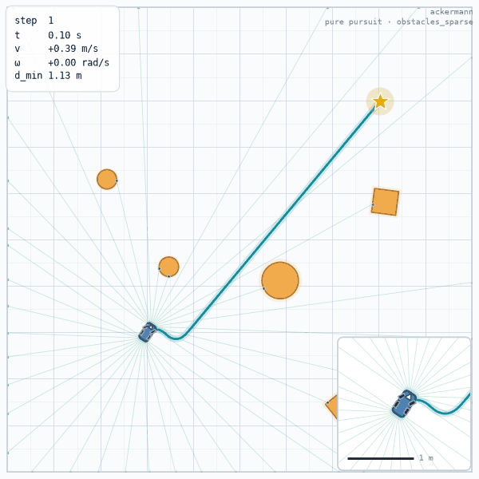
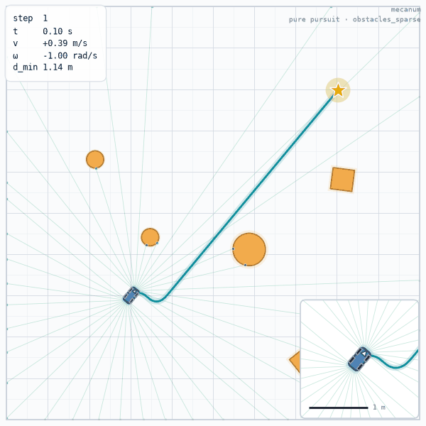
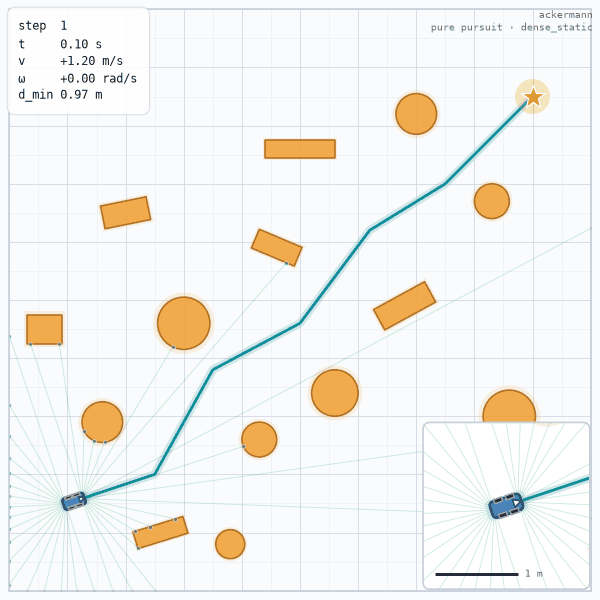
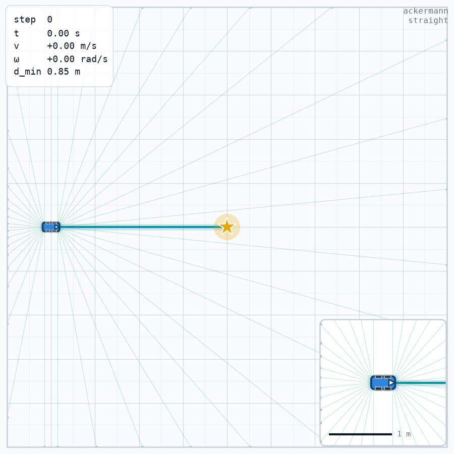
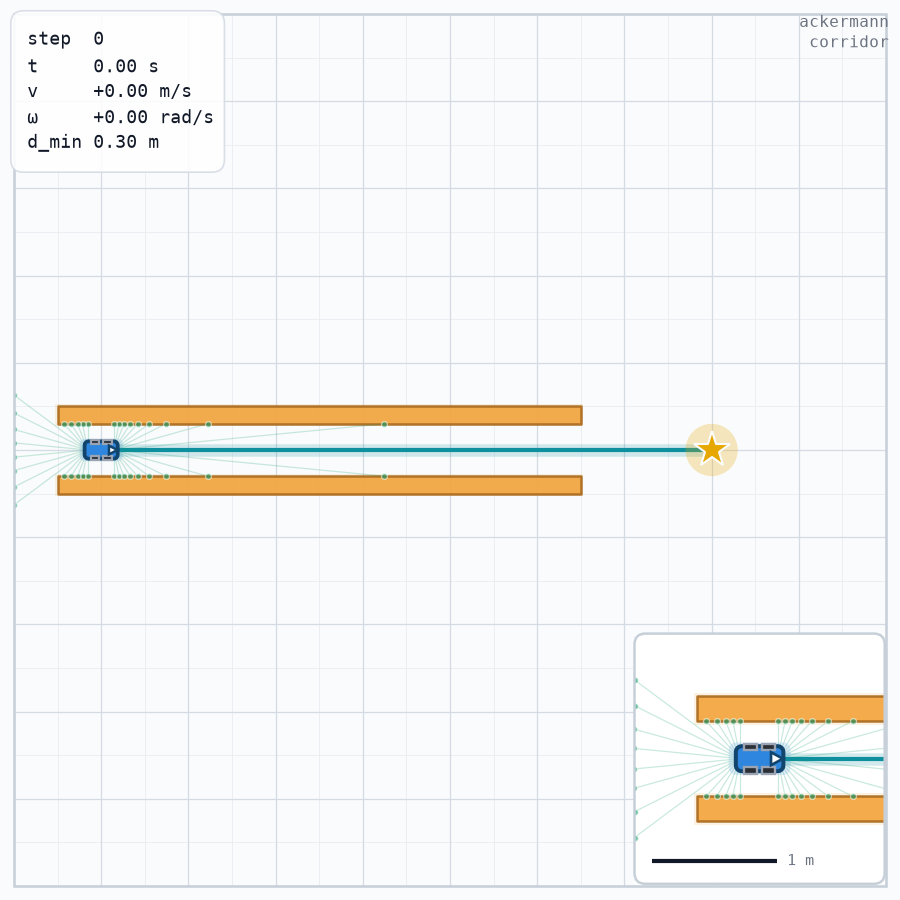
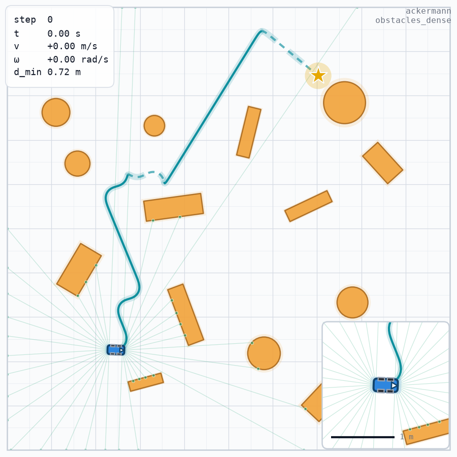
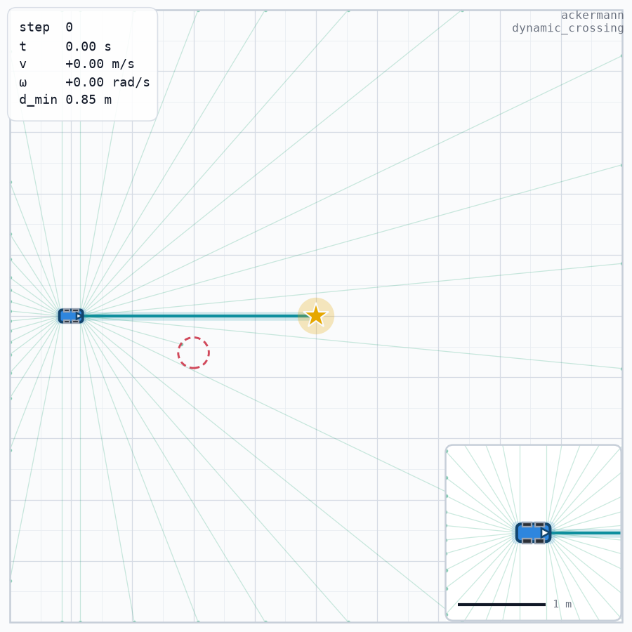

# chassis-sim

[English](https://github.com/ravenkernel/chassis-sim/blob/main/README.md) | 简体中文

[](https://github.com/ravenkernel/chassis-sim/actions/workflows/ci.yml)
[](https://github.com/ravenkernel/chassis-sim)
[](LICENSE)

**轻量、可复现的底盘控制 / 观测 / 奖励工作台** —— 阿克曼、差速、麦轮三种底盘，NumPy 核心，Gymnasium API。

chassis-sim 面向的循环是：改一个控制器、改一段观测布局、改一项奖励，然后在咖啡凉之前知道发生了什么。一个进程、一台机器人、一张地图、显式 seed，不用安装仿真器。这个包刻意保持很小；它实现的部分都精确到比特。

**它不是**权威物理仿真器、接触仿真器，也不是多智能体基准套件。需要接触力、轮胎模型、或成千上万个 GPU 环境时，请用真正的物理栈；chassis-sim 是你测试「不需要这些」的那一层。

## 它是什么（以及不是什么）

适合用它来：

- 迭代路径跟踪器、奖励函数或观测布局，而不用重建一套仿真栈；
- 钉住回归：`reset(seed=...)` 复现地图、传感器流与轨迹；
- 教学或演示底盘运动学：实现可读、依赖少；
- 在固定协议上比较参考控制器，样本独立性检查内置。

需要下面这些时请绕开：

- 权威动力学：悬架、轮胎滑移、载荷转移、3D、或富接触交互；
- 排行榜：评测工具是给你自己的基线用的，不是给全世界排名的；
- GPU 规模 rollout：一个环境就是 CPU 上的一个 Python 对象。

三条不藏的边界：

1. **底盘级运动学，不是轮级刚体动力学。** 状态是 `(x, y, θ)`，每步闭式积分一个常 twist。轮级层只报告转向角与轮速，供日志与下游控制使用，绝不回灌积分器。没有悬架、没有滑移、没有载荷转移、没有 3D。
2. **碰撞是几何判据。** 矩形/圆重叠，加上可选的扫掠采样。碰撞是一个终止回合的布尔值；没有接触力、没有摩擦、没有推挤。
3. **没有 GPU，也没有内置的向量化批量。** 需要并行就用 Gymnasium 的向量封装；库本身不提供批量仿真器。

## 一览

三种底盘，一套归一化动作接口，有限观测 Box，Gymnasium id 全部在 `-v1`。

| Gymnasium id | 底盘 | 动作布局 | 默认观测 | 物理限幅（默认 `EnvConfig`） |
| --- | --- | --- | ---: | --- |
| `ChassisSim-Ackermann-v1` | 阿克曼 | `[steer, speed]` | 128 | `v ∈ [-0.6, 1.2] m/s`，`δ ∈ [-0.526, 0.526] rad`，`|ω| ≤ 4.805 rad/s` |
| `ChassisSim-DiffDrive-v1` | 差速 | `[speed, yaw]` | 128 | `v ∈ [-1.2, 1.2] m/s`，`|ω| ≤ 1.0 rad/s` |
| `ChassisSim-Mecanum-v1` | 麦轮 | `[vx, vy, yaw]` | 129 | `v_x ∈ [-1.2, 1.2] m/s`，`|vy| ≤ 0.5 m/s`，`|ω| ≤ 1.0 rad/s` |

动作空间统一为 `Box(-1, 1, (d,), float32)`；底盘把归一化动作映射到物理量，所以你不需要提供电压、力矩或原始转向角。上表的限幅就是默认配置下 `env.chassis.describe()["limits"]` 报告的值。换一份 `EnvConfig` 会同时改变物理映射与动作语义。

3.0.0 是 API 稳定线：从这一版起公共 API 遵循语义化版本，破坏性改动必须升主版本。`chassis_sim.__version__` 报告已安装版本。

## 安装

```bash
pip install chassis-sim
pip install "chassis-sim[planning]"
pip install "chassis-sim[viz]"
pip install "chassis-sim[dev]"
```

Python 3.10+。核心依赖是 `numpy>=1.24`、`gymnasium>=0.29`、`pyyaml>=6.0`。

- `planning` 增加 `numba>=0.60`，这是第一个带 NumPy 2 二进制的版本，供 Hybrid-A* 与 Reeds-Shepp 场景使用。核心场景与默认 `dense_static` 地图不需要它。
- `viz` 增加 `matplotlib>=3.7` 与 `imageio>=2.28`，用于录制与静帧。
- `dev` 增加 `pytest`、`pytest-cov`、`mypy`、`types-PyYAML`。

## 快速开始

```python
import chassis_sim as cs

env = cs.make("ackermann", max_steps=200)
obs, info = env.reset(seed=0)
print("observation:", obs.shape, obs.dtype)

for _ in range(3):
    obs, reward, terminated, truncated, info = env.step([0.2, 0.6])
print(
    "step:",
    info["step"],
    "| cte:",
    round(info["cte"], 3),
    "| done:",
    terminated or truncated,
)
```
```text
observation: (128,) float32
step: 3 | cte: -0.008 | done: False
```

`reset(seed=0)` 同时固定默认场景与机器人状态。不传 seed 时，每次 `reset()` 都会重掷默认 `dense_static` 场景的障碍场——这是设计行为，不是 bug。同一个 seed 两次会得到同一张地图：

```python
import hashlib
import json

import chassis_sim as cs


def fingerprint(env):
    shapes = env.unwrapped.bridge.obstacle_shapes()
    blob = json.dumps(shapes, sort_keys=True).encode()
    return len(shapes), hashlib.sha256(blob).hexdigest()[:8]


env = cs.make("ackermann")
for label, kwargs in (
    ("seed=0", {"seed": 0}),
    ("seed=0 again", {"seed": 0}),
    ("no seed", {}),
    ("no seed again", {}),
):
    env.reset(**kwargs)
    count, digest = fingerprint(env)
    print(f"{label:14s} obstacles={count:2d} digest={digest}")
```
```text
seed=0         obstacles=12 digest=8e794457
seed=0 again   obstacles=12 digest=8e794457
no seed        obstacles=13 digest=1276d1b6
no seed again  obstacles=12 digest=32a57ddd
```

`reset()` 按这个顺序选场景：

1. 传了 `options=` 就原样使用，包括 `{}`。传 `{}` 会同时跳过场景默认值与 `default_scenario`，落到旧的直线兜底。
2. `cs.make(..., scenario=...)` 附加的 `env.default_reset_options`。
3. 当 `options is None`、环境自己持有 bridge、且没有设置 `map_generator` 时，用 `EnvConfig.default_scenario`（默认 `"dense_static"`）。
4. 当 `default_scenario=None` 时，用旧的直线兜底。

显式 options 原样使用：环境不会对你提供的障碍做抖动、丢弃或重新播种。

```python
import numpy as np

import chassis_sim as cs

env = cs.make("ackermann", scenario="corridor")
env.reset(seed=0)
print("scenario obstacles:", len(env.unwrapped.bridge.obstacle_shapes()))

env.reset(seed=0, options={})
print("options={} obstacles:", len(env.unwrapped.bridge.obstacle_shapes()))

env.reset(
    seed=0,
    options={
        "obstacles": [
            {"shape": {"name": "circle", "radius": 0.3}, "state": [3.0, 5.0, 0.0]}
        ],
        "path_waypoints": np.array([[1.0, 5.0, 0.0], [9.0, 5.0, 0.0]]),
    },
)
print("explicit obstacles:", len(env.unwrapped.bridge.obstacle_shapes()))
```
```text
scenario obstacles: 2
options={} obstacles: 0
explicit obstacles: 1
```

## 图库

十一份素材，一条命令在场景 seed 0 下全部重建：

```bash
python examples/gallery.py --out assets
```

五段 GIF 是真实闭环跑出来的 12 fps 回放：控制器从 seed-0 的 reset 状态出发驱动环境，
录下来的动作序列再从同一初态重放，因此每段都可复现，也都真的到达了目标。六张静图是
场景的初始状态（`reset` 后第 0 步，底盘 `ackermann`，不挂控制器），画面里带障碍场、
参考路径、车体，以及角落里的底盘名与场景名。每张图链到 `assets/` 下的原尺寸文件。

### 底盘运动学 —— 一条参考路径，一个控制器

三台底盘跑同一条 `obstacles_sparse` 路径、用同一个 `pure_pursuit` 控制器，唯一的
变量就是运动学。

<table>
<tbody>
<tr>
<td align="center" width="33%"><a href="https://raw.githubusercontent.com/ravenkernel/chassis-sim/main/assets/chassis_ackermann.gif"></a><br><code>chassis_ackermann.gif</code><br><em>obstacles_sparse · ackermann · pure_pursuit</em></td>
<td align="center" width="33%"><a href="https://raw.githubusercontent.com/ravenkernel/chassis-sim/main/assets/chassis_diff_drive.gif"></a><br><code>chassis_diff_drive.gif</code><br><em>obstacles_sparse · diff_drive · pure_pursuit</em></td>
<td align="center" width="33%"><a href="https://raw.githubusercontent.com/ravenkernel/chassis-sim/main/assets/chassis_mecanum.gif"></a><br><code>chassis_mecanum.gif</code><br><em>obstacles_sparse · mecanum · pure_pursuit</em></td>
</tr>
</tbody>
</table>

前轮转向受最小转弯半径约束，阿克曼车过弯必须甩出去一段。差速底盘没有横向自由度，
转向全靠左右轮速差，在同一条路径上读起来就是更紧的一次折角。麦轮多一维正交速度分量，
直接在车体上做横向修正，因此最贴合参考线。

### 控制器 —— 一台底盘，一个场景

两段 GIF 都是 `ackermann` 底盘跑 `dense_static`，差别只在控制器。

<table>
<tbody>
<tr>
<td align="center" width="50%"><a href="https://raw.githubusercontent.com/ravenkernel/chassis-sim/main/assets/controller_pure_pursuit.gif"></a><br><code>controller_pure_pursuit.gif</code><br><em>dense_static · ackermann · pure_pursuit</em></td>
<td align="center" width="50%"><a href="https://raw.githubusercontent.com/ravenkernel/chassis-sim/main/assets/controller_dwa.gif"></a><br><code>controller_dwa.gif</code><br><em>dense_static · ackermann · dwa</em></td>
</tr>
</tbody>
</table>

一段前视圆弧让纯追踪跟得平顺，代价是切弯、车体离障碍更近。速度窗采样加上障碍代价让
DWA 走更保守的一条线，用更少的步数收工。

### 场景 —— 俯视图

<table>
<tbody>
<tr>
<td align="center" width="50%"><a href="https://raw.githubusercontent.com/ravenkernel/chassis-sim/main/assets/scene_straight.png"></a><br><code>scene_straight.png</code><br><em>straight · seed 0 · reset 后第 0 步</em></td>
<td align="center" width="50%"><a href="https://raw.githubusercontent.com/ravenkernel/chassis-sim/main/assets/scene_corridor.png"></a><br><code>scene_corridor.png</code><br><em>corridor · seed 0 · reset 后第 0 步</em></td>
</tr>
<tr>
<td align="center" width="50%"><a href="https://raw.githubusercontent.com/ravenkernel/chassis-sim/main/assets/scene_dense_static.png"></a><br><code>scene_dense_static.png</code><br><em>dense_static · seed 0 · reset 后第 0 步</em></td>
<td align="center" width="50%"><a href="https://raw.githubusercontent.com/ravenkernel/chassis-sim/main/assets/scene_obstacles_dense.png"></a><br><code>scene_obstacles_dense.png</code><br><em>obstacles_dense · seed 0 · reset 后第 0 步</em></td>
</tr>
<tr>
<td align="center" width="50%"><a href="https://raw.githubusercontent.com/ravenkernel/chassis-sim/main/assets/scene_dynamic_crossing.png"></a><br><code>scene_dynamic_crossing.png</code><br><em>dynamic_crossing · seed 0 · reset 后第 0 步</em></td>
<td align="center" width="50%"><a href="https://raw.githubusercontent.com/ravenkernel/chassis-sim/main/assets/scene_obstacles_sparse.png"></a><br><code>scene_obstacles_sparse.png</code><br><em>obstacles_sparse · seed 0 · reset 后第 0 步</em></td>
</tr>
</tbody>
</table>

`straight` 是干净基线：无阻碍，y = 5 处一条 4 m 参考线。`corridor` 把可行域压到两堵
长矩形之间的 0.6 m 带里，所以贴墙余量一眼可读。`dense_static` 是手写的 14 个圆/矩形
贴着参考路径排布，不需要规划器。`obstacles_dense` 与 `obstacles_sparse` 来自
Hybrid-A* 地图生成器，障碍场按 seed 现场生成、不存 YAML：dense 抽 9–15 个贴着路径的
障碍，sparse 在开阔区抽 2–5 个。`dynamic_crossing` 有一个 0.25 m 的圆以 0.3 m/s
沿 20 s 乒乓周期横穿路径，图中画的是它 t = 0 的位姿。

## 观测与动作契约

观测是由有序段拼成的单个 `float32` 向量。`ObsSpec.default(action_dim, points=30)` 是四段——里程计、路径、目标、上一动作——所以在两个 2 维动作底盘上是 128 维，在麦轮上是 129 维。

| 段 | 维度 | 内容 |
| --- | ---: | --- |
| `Odom` | 4 | 车体系 `[dx*10, dy*10, v, ω]` |
| `PathSegment(points=30)` | 120 | 每点 `[ρ, sin φ, cos φ, dθ]`——极坐标，不是笛卡尔 |
| `Goal` | 2 | 目标在车体系的位置 |
| `Act(action_dim)` | d | 上一归一化动作 |
| `LidarSegment` | n_rays | 扫描距离（米） |
| `Err` | 2 | 归一化横向误差与航向误差 |
| `GoalSig` | 2 | 目标航向误差的 `sin` 与 `cos` |
| `PathValid` | 1 | 路径段有效时为 1.0 |
| `PathProgress` | 1 | `[0, 1]` 内的弧长完成度 |
| `Custom` | n | 你的回调 |

每个内置段都声明有限边界，`observation_space` 是有限 `Box`：

- 默认 10 × 10 m 场地里 `world_diag` 为 14.142 m；目标坐标以它为界。
- 路径 `ρ` 以 `world_diag + lookahead + 0.1` 为界。默认 lookahead 是 20.0 m，所以上界是 34.242 m。`sin φ` 与 `cos φ` 在 `[-1, 1]`；`dθ` 在 `[-π, π]`。
- 角度通道以 `π` 为界；归一化通道经 float32 放宽后以 `1 + 1 ulp` = ±1.0000001192092896 为界。
- 越界值先计数再 clip。`info["obs_clipped"]` 只在计数大于 0 时出现；不出现就表示恰好 0。

```python
import numpy as np

import chassis_sim as cs

env = cs.make("ackermann")
low, high = env.observation_space.low, env.observation_space.high
print("all finite:", bool(np.isfinite(low).all() and np.isfinite(high).all()))
print("path rho:", float(low[4]), "..", round(float(high[4]), 3))
print("normalized channel:", float(high[-1]))
```
```text
all finite: True
path rho: 0.0 .. 34.242
normalized channel: 1.0000001192092896
```

### 组合自己的观测

段是可组合的：加一路 lidar、一个进度项或一个自定义特征，是改 spec，不是重写环境。九段 494 维布局就是一条表达式：

```python
import numpy as np

import chassis_sim as cs

env = cs.make(
    "ackermann",
    sensors=[
        cs.Lidar("front", mount=(0.145, 0, 0), n_rays=180),
        cs.Lidar("rear", mount=(-0.155, 0, np.pi), n_rays=180),
    ],
    obs=cs.ObsSpec(
        (
            cs.LidarSegment("lidar", sensors=("front", "rear")),
            cs.Odom(),
            cs.PathSegment(points=30),
            cs.Goal(),
            cs.Act(action_dim=2),
            cs.Err(),
            cs.GoalSig(),
            cs.PathValid(),
            cs.PathProgress(),
        )
    ),
)
print("obs:", env.observation_space.shape)
for name, span in env.obs_spec_describe().items():
    print(f"{name:14s} {span.start:3d}-{span.stop:3d}")
```
```text
obs: (494,)
lidar            0-360
odom           360-364
path           364-484
goal           484-486
act            486-488
err            488-490
goal_sig       490-492
path_valid     492-493
path_progress  493-494
```

`obs_spec_describe()` 返回每段的切片，日志与切片因此只有一个真相源。`action_space` 是 `Box(-1, 1, (d,), float32)`；`reset()` 返回 `(obs, info)`，`step()` 返回五元组 `(obs, reward, terminated, truncated, info)`。

## 传感器

传感器挂在 bridge 上，把读数以传感器名为键发布到 `info`。除非某个 `LidarSegment` 引用它们，否则不会改变观测。

| 传感器 | 构造 | `info` 载荷 |
| --- | --- | --- |
| `Lidar` | `Lidar(name, mount=(x, y, yaw), fov=π, n_rays=180, max_range=10.0, range_min=0.05, noise_std=0, quant_step=0, latency_steps=0, dropout_prob=0)` | `scan`、`scan_meta` |
| `Imu` | `Imu(name, noise_std=0)` | `ax`、`ay`、`yaw_rate`、`yaw`、`t` |
| `WheelOdom` | `WheelOdom(name, track_width=None, noise_std=0)` | `v_left`、`v_right`、`v`、`t` |

默认环境没有传感器，`d_min` 在 lidar 给出更近命中之前一直是 bridge 的 `max_range`（10.0 m）。传感器噪声由 `sensor_seed` 播种；它未设置时回落到 `seed`，两者都未设置时回落到 0。

```python
import numpy as np

import chassis_sim as cs

env = cs.make(
    "ackermann",
    sensors=[
        cs.Lidar("front", mount=(0.145, 0, 0), n_rays=32, max_range=5.0),
        cs.Imu("imu", noise_std=0.02),
        cs.WheelOdom("wheel", track_width=0.2),
    ],
)
obs, info = env.reset(seed=0)
obs, reward, terminated, truncated, info = env.step(np.zeros(2, dtype=np.float32))
print("scan:", info["front"]["scan"].shape, info["front"]["scan"].dtype)
print("imu keys:", sorted(info["imu"]))
print("wheel keys:", sorted(info["wheel"]))
print("d_min:", round(float(info["d_min"]), 4))
```
```text
scan: (32,) float32
imu keys: ['ax', 'ay', 't', 'yaw', 'yaw_rate']
wheel keys: ['t', 'v', 'v_left', 'v_right']
d_min: 0.9812
```

## 底盘与轮级运动学

每种底盘把归一化动作映射成 `ChassisCommand(v, omega, vy)`，并积分一个常 twist。另有一个只读的轮级层报告轮子在做什么。

| 底盘 | 动作布局 | 指令 | 轮级运动学 |
| --- | --- | --- | --- |
| `AckermannChassis` | `[steer, speed]` | `v`、`ω` | 前轮内外转向角 |
| `DiffDriveChassis` | `[speed, yaw]` | `v`、`ω` | 左右轮速 |
| `MecanumChassis` | `[vx, vy, yaw]` | `v`、`vy`、`ω` | 四个轮的角速度 |

`chassis.wheel_kinematics(command)` 是纯函数、只读，绝不回灌积分器。基类对某种底盘没有的量返回 `None`——差速没有转向角，麦轮没有左右一对——而不是空 dict。

- **阿克曼。** 前轮满足 `cot δ_out − cot δ_in = b / L`，默认 `b = 0.2` m、`L = 0.145` m。左转时左轮是内轮，所以 `δ_left > δ_right`。指令 `[1.0, 0.5]` 给出 `δ = 0.526` rad，内轮 `44.03°`、外轮 `22.50°`。
- **差速。** `v_left = v − ω b / 2`，`v_right = v + ω b / 2`。取 `v = 1.0`、`ω = 0.5`、`b = 0.2`，两轮为 0.95 与 1.05 m/s。
- **麦轮。** 逆 Jacobian 给出 `ω_FL = (v − vy − (lx + ly) ω) / r`、`ω_FR = (v + vy + (lx + ly) ω) / r`、`ω_RL = (v + vy − (lx + ly) ω) / r`、`ω_RR = (v − vy + (lx + ly) ω) / r`。正解在测试里逐轮回代检查。

```python
import numpy as np

import chassis_sim as cs

ack = cs.AckermannChassis()
command = ack.command(np.array([1.0, 0.5]))
wheels = ack.wheel_kinematics(command)
print(
    "ackermann command: v =", round(command.v, 3), "| omega =", round(command.omega, 3)
)
print(
    "steering (deg):",
    f"{np.degrees(wheels.steering_left):.2f}",
    f"{np.degrees(wheels.steering_right):.2f}",
)

diff = cs.DiffDriveChassis()
wheels = diff.wheel_kinematics(diff.command(np.array([1.0, 0.5])))
print(
    "diff_drive wheels:",
    wheels.wheel_left,
    wheels.wheel_right,
    "| steering:",
    wheels.steering_left,
)

mecanum = cs.MecanumChassis()
wheels = mecanum.wheel_kinematics(mecanum.command(np.array([1.0, 0.5, 0.5])))
print(
    "mecanum wheels:",
    [
        f"{value:.2f}"
        for value in (
            wheels.wheel_fl,
            wheels.wheel_fr,
            wheels.wheel_rl,
            wheels.wheel_rr,
        )
    ],
)
```
```text
ackermann command: v = 0.5 | omega = 2.0
steering (deg): 44.03 22.50
diff_drive wheels: 0.95 1.05 | steering: None
mecanum wheels: ['12.10', '27.90', '22.10', '17.90']
```

## 控制器

包里带两个参考控制器：

| 控制器 | 默认值 | 说明 |
| --- | --- | --- |
| `PurePursuitController` | `lookahead=0.6`、`adaptive=False`、`lookahead_gain=0.8` | 接受车体系路径 |
| `DwaController` | `dt=0.1`、`horizon=10`、`gear_mode="off"` | 采样动态窗口 |

`cs.make_controller("pp"|"dwa", env=env)` 把控制器绑到环境。裸的 `PurePursuitController()` 会抛 `TypeError`，因为底盘还未知；传 `env=` 或 `chassis=`。`cs.evaluate(env)` 不传控制器时会自动绑纯跟踪。

## 积分与碰撞

状态是 `(x, y, θ)`。每步在 `dt` 上闭式积分常量 `(v, vy, ω)`：

```text
φ = ω dt
A = (sin(θ₀ + φ) − sin θ₀) / ω
B = (cos θ₀ − cos(θ₀ + φ)) / ω
ΔX = v A − vy B
ΔY = v B + vy A
θ = θ₀ + φ
```

这是解析解，不是近似。在 `dt = 0.1` 下，`v = ω = 1` 的整圈在旧 Euler 步进下会偏离自身半径 `5.04e-2` m；同一整圈上闭式解的最坏径向误差是 `3.33e-16` m。

`|ω dt| ≤ sqrt(eps) ≈ 1.49e-8` 的分支逐位复现 Euler 步进，所以 `ω = 0` 的轨迹与上一实现逐位相同（测试比对 144 组 `tobytes()`）。

```python
import math

from chassis_sim.chassis import ChassisCommand, DiffDriveChassis

chassis = DiffDriveChassis(wheelbase=0.145, v_max=1.0, omega_max=1.0)
command = ChassisCommand(v=1.0, omega=1.0)
dt = 0.1
x = y = theta = 0.0
worst = 0.0
for _ in range(round(2 * math.pi / dt)):
    x, y, theta = chassis.integrate(x, y, theta, command, dt)
    worst = max(worst, abs(math.hypot(x, y - 1.0) - 1.0))
print("max radial error:", worst)
```
```text
max radial error: 3.3306690738754696e-16
```

### 积分子步

`integration_substeps`（默认 1，校验为 ≥ 1 的整数）把每个控制步拆成那么多个闭式子步。`substeps=1` 与旧路径逐位相同。闭式积分下把它调高**不会**提高精度——结果已经在浮点噪声上（1 m/s、1 rad/s 的圆弧走 100 步，1 与 4 子步相差 `9.2e-14`）。它改变的是碰撞采样密度：更多中间位姿被测试。为此用它，不要把它当「更好的积分器」。

```python
import numpy as np

from chassis_sim.bridges import SimpleBridge
from chassis_sim.chassis import DiffDriveChassis


def pose_after(substeps):
    bridge = SimpleBridge(
        DiffDriveChassis(wheelbase=0.145, v_max=1.0, omega_max=1.0),
        dt=0.1,
        world_bounds=(0, 10, 0, 10),
        domain_rand=False,
        seed=0,
        integration_substeps=substeps,
    )
    bridge.reset(
        path_waypoints=np.array([[1.0, 5.0, 0.0], [9.0, 5.0, 0.0]]),
        initial_heading=0.0,
    )
    for _ in range(100):
        bridge.step(np.array([1.0, 1.0]))
    pose = bridge.pose()
    bridge.close()
    return np.array(pose)


p1, p4 = pose_after(1), pose_after(4)
print("max |substeps=1 - substeps=4|:", float(np.max(np.abs(p1 - p4))))
```
```text
max |substeps=1 - substeps=4|: 9.237055564881302e-14
```

### 连续碰撞检测

`ccd`（默认 `False`）用同一几何判据对中间位姿做扫掠采样。2 m/s 下 0.1 m 的薄墙——`dt = 0.1` 时一步 2 m——CCD 关时漏掉，开时抓到：

```python
import numpy as np

from chassis_sim.bridges import SimpleBridge
from chassis_sim.chassis import AckermannChassis


def hits(ccd):
    bridge = SimpleBridge(
        AckermannChassis(v_max=20.0, curvature_action=False),
        dt=0.1,
        world_bounds=(0.0, 10.0, 0.0, 10.0),
        domain_rand=False,
        seed=0,
        ccd=ccd,
    )
    bridge.reset(
        obstacles=[
            {
                "shape": {"name": "rectangle", "length": 0.1, "width": 2.0},
                "state": [1.0, 5.0, 0.0],
            }
        ],
        path_waypoints=np.array([[0.9, 5.0, 0.0], [9.0, 5.0, 0.0]]),
        initial_heading=0.0,
    )
    out = []
    for _ in range(2):
        bridge.step(np.array([0.0, 1.0]))
        out.append(bridge.check_collision())
    bridge.close()
    return out


print("ccd=False:", hits(False))
print("ccd=True: ", hits(True))
```
```text
ccd=False: [False, False]
ccd=True:  [True, False]
```

端点检测仍然执行，所以 CCD 的检出集合是离散集合的超集。动态障碍仍只在段末求值。

## 评测与基准

`cs.evaluate(env, controller=None, *, episodes, seed=0, max_steps=None, reset_options=None, labels=None, allow_mismatch=False)` 跑闭环回合，返回 `EvalResult`，含 `n`、`successes`、`collisions`、`timeouts`、三个比率、`mean_steps`、`mean_return`、`min_obstacle_clearance`、`success_interval`、`success_ci`、`map_fingerprints`、`distinct_maps`、`maps_independent`、`same_map_repeated`。

`success_ci` 是 Wilson 95% 区间的半宽。只有回合是独立样本时它才有意义：当 `distinct_maps < n` 时，基准层返回 `None` 并置 `maps_independent=False`，而不是拿重复地图算出一个数字。

```python
import chassis_sim as cs

env = cs.make("ackermann", max_steps=300)
result = cs.evaluate(env, episodes=10, seed=0)
print(
    "n:",
    result.n,
    "success:",
    f"{result.success_rate:.0%}",
    "steps:",
    f"{result.mean_steps:.1f}",
    "collisions:",
    result.collisions,
)
print(
    "distinct_maps:",
    result.distinct_maps,
    "maps_independent:",
    result.maps_independent,
    "ci:",
    round(result.success_ci, 3),
)
```
```text
n: 10 success: 100% steps: 102.0 collisions: 0
distinct_maps: 10 maps_independent: True ci: 0.278
```

### 基准工具

`chassis_sim.eval.benchmark(...)` 在策略 × 场景 × seed 上跑同一协议；`python -m chassis_sim benchmark` 是命令行入口。内置四个基线：`zero`、`random`、`pp`、`dwa`。

```bash
python -m chassis_sim benchmark \
  --scenarios obstacles_sparse \
  --seeds 0 1 2 \
  --episodes 5 \
  --max-steps 300 \
  --out /tmp/benchmark.md
```

那次运行的跨 seed 汇总：

| 策略 | 成功率 | 95% CI | 碰撞 | 平均步数 | 不同地图 | 独立 |
| --- | ---: | ---: | ---: | ---: | ---: | --- |
| `zero` | 0.0% | ±20.4% | 0 | 300.0 | 15 | True |
| `random` | 0.0% | ±20.4% | 6 | 242.8 | 15 | True |
| `pp` | 100.0% | ±20.4% | 0 | 88.9 | 15 | True |
| `dwa` | 100.0% | ±20.4% | 0 | 74.4 | 15 | True |

最值得看的是最后一列。十五个回合产生了十五张不同地图，所以 ±20.4% 的 Wilson 半宽是对十五个独立样本的陈述。现在跑 `benchmark` 在省略 `--scenarios` 时的默认场景：

```python
from chassis_sim.eval import benchmark

result = benchmark(scenarios=["straight"], seeds=[0, 1, 2], episodes=2)
for summary in result.summaries:
    ci = "—" if summary.success_ci is None else f"{summary.success_ci:.1%}"
    print(
        f"{summary.policy:6s} success={summary.success_rate:.0%} ci={ci} "
        f"distinct_maps={summary.distinct_maps} independent={summary.maps_independent}"
    )
```
```text
zero   success=0% ci=— distinct_maps=1 independent=False
random success=0% ci=— distinct_maps=1 independent=False
pp     success=100% ci=— distinct_maps=1 independent=False
dwa    success=100% ci=— distinct_maps=1 independent=False
```

`straight` 是单张固定地图。工具拒绝为它编造置信区间：`success_ci` 是 `None`、`maps_independent` 是 `False`，markdown 输出打印 `—`。`maps_independent=False` 的表是调试辅助，不是可以引用的结果。`benchmark` 在 seed 少于三个时还会警告并置 `protocol_ok=False`。

## 命令行

包会安装 `chassis-sim` 控制台脚本；`python -m chassis_sim` 是同一个程序。

```bash
chassis-sim list-scenarios
chassis-sim eval --scenario dense_static --controller pp --episodes 20 --seed 0
chassis-sim record --scenario corridor --controller dwa --out demo.gif --steps 200 --every 4 --fps 12
chassis-sim render --scenario straight --out frame.png --seed 0
python -m chassis_sim benchmark --scenarios obstacles_sparse --seeds 0 1 2 --episodes 5 --max-steps 300 --out -
```

`benchmark --out -` 打印表格、不写文件。`eval`、`record`、`render` 默认用不依赖规划器的 `corridor` 场景；`benchmark` 默认 `straight`，正好就是上面那个重复地图的例子。`record` 与 `render` 需要 `viz` extra，matplotlib 或 imageio 缺失时以状态 2 退出并给一行提示。规划场景需要 `planning` extra，numba 缺失时同样处理。

## 示例

`examples/` 下有七个可直接运行的脚本。每个都会打印它所演示的内容，且只需要上面提到的对应 extra。

| 脚本 | 演示什么 |
| --- | --- |
| `examples/scenario_demo.py` | 用 `cs.make` 驱动三个不依赖规划器的场景 |
| `examples/sensors_demo.py` | IMU、轮速计，以及带延迟与丢帧的参数化 LiDAR |
| `examples/dynamic_demo.py` | `dynamic_crossing`：同一段开环动作在静态与动态障碍下的对照 |
| `examples/eval_matrix.py` | 十张独立地图上的控制器 × 车型矩阵 |
| `examples/benchmark_baselines.py` | 四个基线，输出就是上面那张基准表 |
| `examples/render_demo.py` | 10 m × 10 m 场地里沿规划轨迹跑到出图的完整渲染 |
| `examples/gallery.py` | 本页用到的图片与动图 |

## 配置

`EnvConfig` 是单个 dataclass（48 个字段），覆盖场地、底盘、观测、传感器与默认场景。`to_yaml()` 写快照，`from_yaml()` 读回；`cs.make(cfg, **overrides)` 让显式关键字参数压过配置。

```python
import chassis_sim as cs

cfg = cs.EnvConfig(chassis="ackermann", dt=0.1, max_steps=300)
print("fields:", len(cfg.__dataclass_fields__))
print("default_scenario:", cfg.default_scenario)
print("integration_substeps:", cfg.integration_substeps, "| ccd:", cfg.ccd)
path = cfg.to_yaml("/tmp/chassis_sim_env.yaml")
print("first line:", path.read_text().splitlines()[0])
print("roundtrip:", cs.EnvConfig.from_yaml(path) == cfg)
```
```text
fields: 48
default_scenario: dense_static
integration_substeps: 1 | ccd: False
first line: delta_max: 0.526
roundtrip: True
```

对 3.0.0 行为最要紧的字段是 `default_scenario`、`integration_substeps`、`ccd`、`seed`、`sensor_seed`。`seed` 是环境自建 bridge 时的运行种子；`reset(seed=...)` 显式设置本次 reset 的种子，`sensor_seed` 未设置时由 `seed` 派生。

## 场景

十一个场景以 YAML 提供。核心场景不需要 extra；规划场景需要 `numba`。

| 场景 | Extra | 障碍数（YAML 定义） | 说明 |
| --- | --- | ---: | --- |
| `straight` | — | 0 | `y = 5` 处 4 m 参考线 |
| `corridor` | — | 2 | 两堵长墙之间 0.6 m 的带 |
| `dense_static` | — | 14 | 手写默认场景 |
| `dynamic_crossing` | — | 移动 | 0.25 m 圆以 0.3 m/s 横穿 |
| `circle` | — | 0 | 圆形参考路径 |
| `obstacles_sparse` | planning | 2–5 | Hybrid-A* 地图 |
| `obstacles_medium` | planning | 5–9 | Hybrid-A* 地图 |
| `obstacles_dense` | planning | 9–15 | Hybrid-A* 地图 |
| `obstacles_dense_reverse` | planning | 8–14 | 含倒车段 |
| `foldback_reverse` | planning | 10–16 | 宽航向范围与折返 |
| `maze_grid` | planning | 网格 | 1.0 m 网格、填充率 0.4–0.7 |

`cs.make(..., scenario=name)` 会附加该场景的 `default_reset_options`，所以 `reset(seed=0)` 用它的固定地图。不传场景就得到快速开始里那张每次重掷的 `dense_static` 默认图。`cs.load_scenario(name)` 返回解析后的 `Scenario` 记录；拼错名字会抛 `ScenarioNotFoundError`，不会静默兜底。`chassis_sim.scenarios.scenario_reset_options_factory(name, base_seed=0)` 返回一个每回合产新地图的可调用对象——基准就是这么用的。上表的障碍数是 YAML 的定义值。`dense_static` 的默认重掷每次 reset 会施加最多 0.10 m 的位姿抖动，并以 0.15 的概率丢弃障碍（至少保留六个），所以它的实时 bridge 暴露的形状可能更少；场景默认值与显式 `options` 均原样使用。

## 渲染

`ChassisSimEnv(render_mode=...)` 接受 `None`、`"human"`、`"rgb_array"`。`gym.make(id, render_mode=...)` 与 `cs.make(..., render_mode=...)` 都透传模式。`metadata` 是 `{"render_modes": ["human", "rgb_array"], "render_fps": 10}`；`render_fps` 由 `dt` 推出，`max(1, round(1 / dt))`，所以 `dt = 0.1` 得 10 fps。`reset()` 之后，`rgb_array` 的 `render()` 返回 `uint8`、形状 `(600, 600, 3)`，`human` 返回 `None`。`render_mode=None` 时 `render()` 会告警并返回 `None`，而不是静默什么都不做。

```python
import gymnasium as gym

import chassis_sim  # noqa: F401 - importing the package registers the -v1 ids

env = gym.make("ChassisSim-Ackermann-v1", render_mode="rgb_array")
obs, info = env.reset(seed=0)
frame = env.render()
print("frame:", frame.shape, frame.dtype)
print("metadata:", env.metadata)
env.close()
```
```text
frame: (600, 600, 3) uint8
metadata: {'render_modes': ['human', 'rgb_array'], 'render_fps': 10}
```

`cs.record(env, controller, out="demo.gif", every=4, fps=12)` 与 `cs.snapshot(env, "frame.png")` 在 `viz` extra 里；`chassis-sim render` 写单张 PNG。

## 从 2.x 迁移

3.0.0 是 API 稳定线。相对 2.x 的破坏面恰好三项：

1. **Gymnasium id 从 `-v0` 移到 `-v1`。** `-v0` 已不再注册；`gym.make("ChassisSim-Ackermann-v0")` 抛 `DeprecatedEnv`，并指出应改用 `-v1`。
2. **默认场景变了。** `EnvConfig.default_scenario` 默认 `"dense_static"`，不带显式 seed 的 `reset()` 会重掷该地图。设 `default_scenario=None` 恢复 2.x 的直线兜底，或传 `scenario="straight"`。
3. **观测空间是有限的。** `observation_space` 现在是 low/high 全部有限的 `Box`；2.x 对外是无界 Box。依赖无限边界的代码要改用新值（上面的契约列了它们）。

```python
import warnings

import gymnasium as gym

import chassis_sim  # noqa: F401 - importing the package registers the -v1 ids

warnings.filterwarnings("ignore", category=DeprecationWarning)
try:
    gym.make("ChassisSim-Ackermann-v0")
except gym.error.DeprecatedEnv as exc:
    print(f"{type(exc).__name__}: {exc}")
```
```text
DeprecatedEnv: Environment version v0 for `ChassisSim-Ackermann` is deprecated. Please use `ChassisSim-Ackermann-v1` instead.
```

2.x 公共 API 的其余部分照常工作。`CHANGELOG.md` 有发布说明。

## 许可证、贡献与引用

MIT。见 `LICENSE`。

贡献——开发环境、PR 必须通过的精确闸门、以及什么样的 PR 好审——在 `CONTRIBUTING.md`。安全问题走 `SECURITY.md` 描述的私密渠道，不要开公开 issue。

测试与 lint：

```bash
env -u PYTHONPATH pytest -q
ruff check .
```

CI 在 Python 3.10、3.11、3.12、3.13 上跑测试（`.github/workflows/ci.yml`）。

如果在学术工作中使用本包，请引用仓库——同样的元数据以机器可读形式写在 `CITATION.cff` 里，GitHub 的「Cite this repository」按钮读的就是它：

```bibtex
@software{chassis_sim_2026,
  author = {ravenkernel},
  title = {chassis-sim: Gymnasium environments for Ackermann, differential-drive
           and mecanum chassis},
  year = {2026},
  url = {https://github.com/ravenkernel/chassis-sim}
}
```

---

本 README 里每个 `python` 块都由 `tools/check_readme_blocks.py` 原样执行；每块下面的 `text` 是那次运行的 stdout。版本号指发布线；`pyproject.toml` 仍是已安装版本的唯一真相源。
